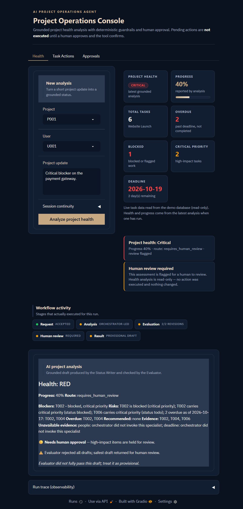
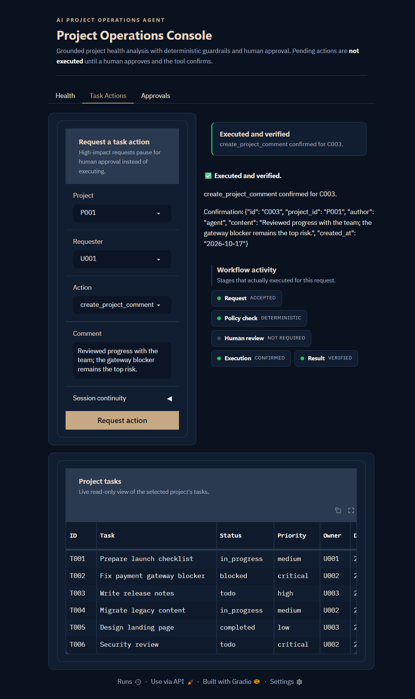
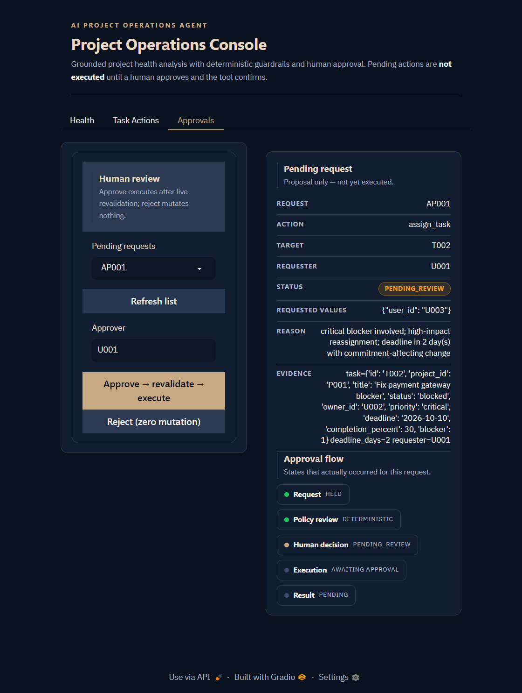
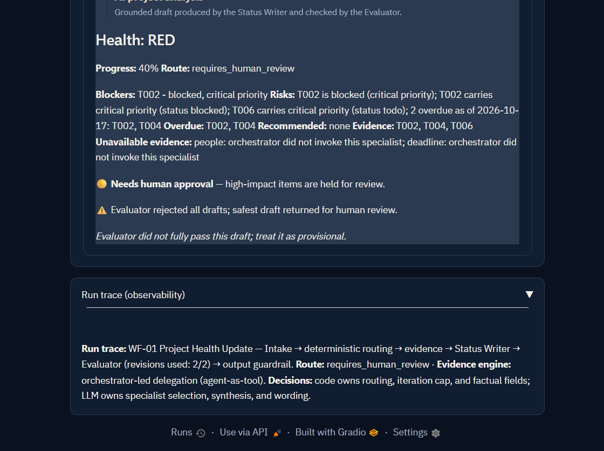
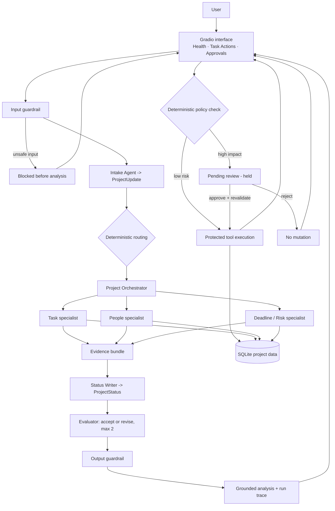

# AI Project Operations Agent

A **local-first, AI-assisted project operations application**: it turns a short project update into a grounded health analysis, supports structured task actions, and routes high-impact changes through explicit human approval.

`Python` · `OpenAI Agents SDK` · `Gradio` · `SQLite` · `Pydantic` · `Ollama`

> Synthetic demo data only. No real project, customer, or personal data is used.

## Application screenshots

| Health | Task Actions |
|---|---|
|  |  |
| Live health run: deterministic `RED` health, progress, blockers, and the grounded analysis. | A low-risk `create_project_comment` executes with a tool confirmation; high-impact actions are held. |

| Approvals | Workflow trace |
|---|---|
|  |  |
| A high-impact `assign_task` held for review: reason, evidence, and the approve/reject controls. | The in-app run trace: workflow, route, evidence engine, and evaluation revisions. |

## What it does

Project updates arrive as free text — for example, *"the gateway fix is waiting on the vendor"*. The app analyses the update together with the project's stored data and reports:

- project health, progress, overdue work, blockers, and risks, grounded in the project's stored rows;
- task workflows (`create_task`, `update_task`, `assign_task`, `create_project_comment`) with structured results and tool confirmations;
- high-impact actions **held for human approval** instead of executed.

Nothing that changes project data happens without passing deterministic rules, and protected actions only run after a human approves and the tool confirms.

## Key features

- **Multi-agent analysis** — Intake, Project Orchestrator, Task, People, Deadline/Risk, Status Writer, and Evaluator agents.
- **Grounded reporting** — the health classification and the overdue/blocked/risk facts are computed from stored rows, not from model opinion.
- **Task actions with workflow results** — four typed actions return an explicit executed / pending / rejected outcome.
- **Input and output guardrails** — input screening, output grounding checks, and tool-input validation.
- **Human-in-the-loop approval** — high-impact requests pause before any mutation and are approved or rejected explicitly.
- **Local data and tracing** — SQLite project storage plus an in-app run-trace panel, with no cloud requirement.

## Architecture



- **Gradio** collects input and displays results across three tabs.
- **Agent / workflow layer** coordinates the analysis and the specialist work.
- **Python tools and business rules** validate operations and control every side effect.
- **SQLite** stores the project data the tools read and write.
- **Approval layer** keeps high-impact actions paused until a human decides.

Not every request follows every path: unsafe input stops at the guardrail, the orchestrator only invokes the specialists a case needs, and only task actions can reach the approval layer.

## How it works

**Health analysis (read-only).**

1. You submit a short project update in the Health tab.
2. The input guardrail screens it for injection or bypass attempts.
3. The Intake Agent extracts a structured `ProjectUpdate`; deterministic rules choose the route.
4. The Project Orchestrator delegates to the specialists a case needs; each reads SQLite through typed, read-only tools, and their evidence is merged.
5. The Status Writer drafts a `ProjectStatus`; the Evaluator accepts it or requests one revision (at most two).
6. The output guardrail validates the result; health, overdue, and blocker facts come from the stored rows.
7. The grounded analysis and the run trace are returned. No project record is modified.

**Task action (may be protected).**

1. You request an action in the Task Actions tab.
2. Deterministic policy classifies it: low-risk actions execute through a typed tool and are verified.
3. High-impact actions are held as a pending request — nothing is executed.
4. In the Approvals tab you approve (revalidate → execute → verify) or reject (no mutation).

## Technology stack

| Technology | Purpose |
|---|---|
| Python 3.11+ | Application logic and orchestration |
| OpenAI Agents SDK | Agent definitions and workflow execution |
| Gradio 6 | Three-tab web interface |
| SQLite | Local project-data storage |
| Pydantic 2 | Structured outputs and validation |
| Ollama / OpenRouter / Mistral / OpenAI | Local or configured LLM inference |
| pytest | Automated offline test suite |

## Run locally (Windows PowerShell)

```powershell
python -m venv .venv
.\.venv\Scripts\Activate.ps1
pip install -r requirements.txt
python seed_database.py        # creates data/projectops.db (synthetic data)
Copy-Item .env.example .env    # local Ollama config (contains no secrets)
```

The default backend is a local Ollama model, so no cloud key is required. In a separate terminal:

```powershell
ollama serve
ollama pull llama3.2
```

Then launch the app:

```powershell
python app.py                  # http://127.0.0.1:7860/
```

`LLM_PROVIDER`, `LLM_MODEL`, and `OLLAMA_BASE_URL` are read from the environment (a `.env` file is loaded at startup). Ollama is required for live analysis. A hosted provider key (for example `OPENROUTER_API_KEY` or `MISTRAL_API_KEY`) is optional and only needed if you switch `LLM_PROVIDER` away from the default.

## Testing

```powershell
python -m pytest tests/ -q
```

This reports **203 passing tests** (~30 seconds). The suite is offline-safe: it needs no API key and no running model server. It exercises the real guardrails, tools, approval lifecycle, and workflows, faking only the single LLM call boundary. Tests cover application behaviour and the safety-related paths — routing, guardrails, approval, and fail-closed handling.

The 12 demonstration scenarios and their evidence are documented in [Demo Scenarios](docs/DEMO_SCENARIOS.md).

## Safety design and limitations

The language model interprets the update and drafts wording; deterministic Python decides routing, health classification, and every side effect. There is no direct LLM database access, no success is claimed without a tool confirmation, and no mutation occurs before an explicit approval. No safety rule lives in a prompt — `prompts/` ships generic public templates, so replacing them cannot bypass the rules.

- Local small models such as `llama3.2` can produce thin drafts and occasionally overclaim; the Evaluator and output guardrail catch this and label the result provisional, though a stronger model gives steadier analyses.
- A configured local model (Ollama by default) is required for live runs; without it, analysis fails closed rather than fabricating a result.
- Remote trace export needs `OPENAI_API_KEY`; on local Ollama it is skipped, and the in-app run trace is the evidence.

The engineering focus: combining AI-assisted analysis with structured workflows, validation, and controlled execution, where the model proposes and deterministic logic plus human review dispose.
